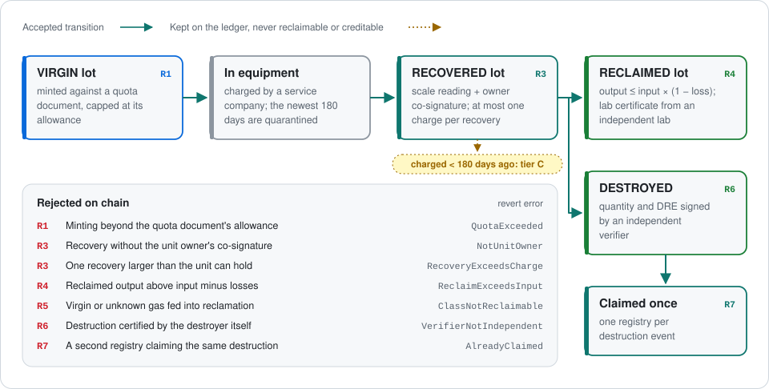
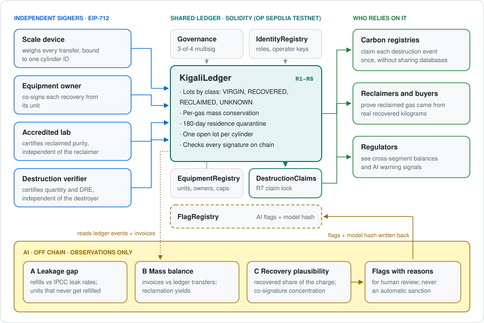
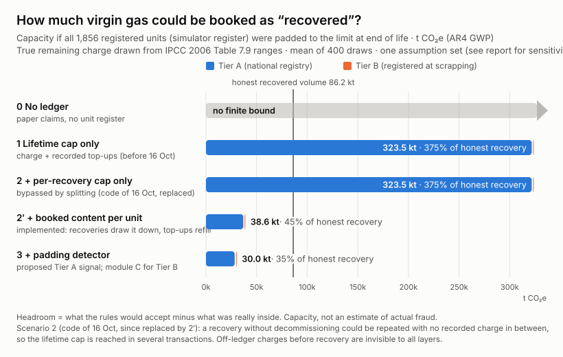
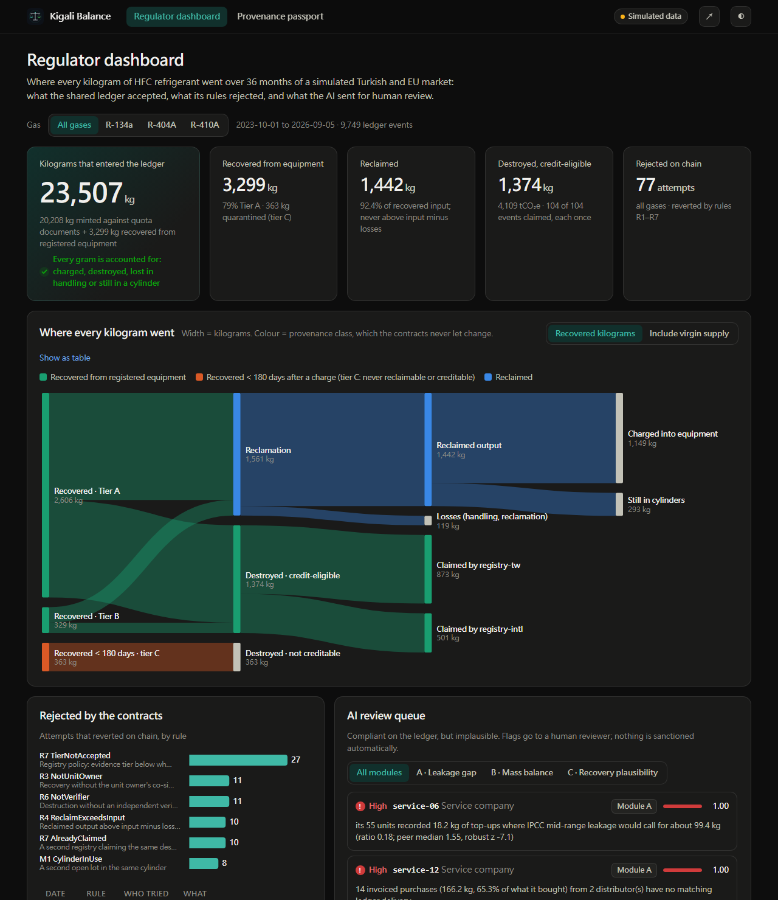
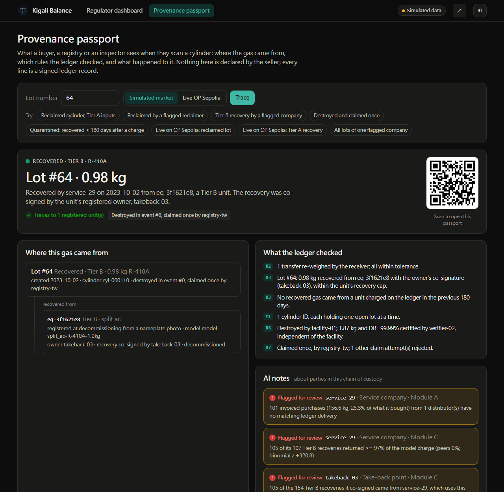

<div align="center">


# Kigali Balance

**Every kilogram has to add up.**<br>
A shared ledger that reconciles recovered, reclaimed and destroyed HFC refrigerant across reclaimers, borders and carbon registries.

[](https://ieee-climatechain-hack.devpost.com/)
[](src/)
[](test/)
[](#live-on-op-sepolia)
[](#honest-limits)
[](#license)

[Problem](#the-problem) · [Gap](#what-already-exists) · [Solution](#the-solution) · [Architecture](#architecture) · [Results](#results) · [Dashboard](#dashboard-and-provenance-passport) · [Live demo](#live-on-op-sepolia) · [Quick start](#quick-start) · [Limits](#honest-limits)

</div>

---

## The problem

HFC refrigerants are super-pollutants: one kilogram of R-404A warms the planet as much as about **3.9 t of CO₂**. Their kilograms are recorded in separate systems: customs quotas, technician logbooks, reclaimer reports and carbon-credit registries. Each system now checks its own records. **No one checks the same kilogram between them.**

That seam is where the value is.

| Weak point | What goes wrong | Evidence |
|---|---|---|
| The **"reclaimed"** label | Gas reclaimed in the EU is exempt from its servicing ban until 2030 and sold at a premium (reclaimed R-404A cost 140% of virgin in Q1 2025). Virgin R-404A has been sold as reclaimed. | EU price monitoring; Cooling Post, Apr 2025 |
| **Carbon credits** | Reclaimed and destroyed HFCs earn credits. Whether a kilogram was "not credited elsewhere" is a supplier declaration, not a check. | ACR; Isometric protocol v1.0 |
| **End of life** | Japan recovered only 43% of the HFC in scrapped equipment in 2024; 6,878 t (12.6 MtCO₂e) was released. | Japan MOE, 2026 |
| **Illegal trade** | EU seizures rose from about 250 t (2023) to about 670 t (2024), including virgin gas labelled as reclaimed. | EIA, Apr 2026 |

> **If virgin gas is labelled reclaimed, a carbon credit is paid for virgin gas.** The "reclaimed" fraud and the crediting problem are one conservation problem.

Full argument and sources: the two-page [problem statement (PDF)](docs/proposal/Kigali_Balance_Problem_Statement.pdf).

## What already exists

Each of these reconciles its own kilograms well. None reconciles a reclaimer's output against recovery recorded elsewhere, or a destruction event against every registry that might credit it.

| System | What it reconciles | What it cannot see |
|---|---|---|
| US EPA (40 CFR 82, 84) | Reclaimer input and output per gas; annual independent audit | US only; not linked to credit registries |
| EU F-gas Portal, customs, Art. 26 reports | Quota at the border; annual reclaimed and destroyed totals | Reclaimers do not report recovered input |
| Japan RaMS | Electronic manifests from recovery to destruction | One country; recovery still near 43% |
| Türkiye FARAVET / EKOMVET | Quotas, shipment documents, 21,456 equipment records | Not linked to EU systems |
| Isometric, Verra, ACR | Chain of custody per container, inside one registry | Uniqueness across registries is a declaration |

**We checked this against real public records** ([audit](docs/research/03-registry-audit.md), [data](research/registry-audit/)). The audit covers 436 ODS/HFC destruction and reclamation projects at ACR, CAR and Verra, plus California's ARB issuance table, all accessed 2026-10-16:

- **Where two ledgers share a key, the public record can be checked, and it reconciles.** ARB issues credits only after the registry retires the matching registry credits. For 291 ARB reporting periods, 270 match the registry exactly, 21 are lower on the ARB side, and none are higher. This is a working cross-ledger claim lock, but it operates per project period, not per kilogram.
- **Between ACR, CAR and Verra there is no shared key.** 68.6% of the 42.4 million destruction credits come from projects that publish no certificate-of-destruction identifier in any form. Where identifiers are public, they come in three incompatible forms, and no registry publishes which container and how many kilograms each credit draws on.
- **The exposure is structural.** Three U.S. destruction facilities sit behind 75.7% of the destruction credits. ACR and CAR projects both have credited destruction windows at the same facility in the same month (50 months at one facility). We found **no evidence of double counting**; the point is that an outsider cannot check.

A shared ledger is only justified where **no single trusted operator spans all the parties**: several independent carbon registries, competing reclaimers, and recovered gas shipped across borders for destruction. Inside one country, a regulator's database is enough.

## The solution

> **Every kilogram claimed as "reclaimed" or "destroyed" must trace back to a kilogram recovered from a real, registered piece of equipment.**

<picture>
  <source media="(prefers-color-scheme: dark)" srcset="docs/assets/kilogram-flow-dark.svg">
  
</picture>

| Layer | What it does |
|---|---|
| **Physical anchors** | Signed scale readings bound to one cylinder ID; each recovery co-signed by the unit's owner; lab and destruction certificates signed by parties independent of the operator. All EIP-712, verified on chain. |
| **Conservation rules** | Per-gas mass conservation, provenance classes that cannot be swapped, a booked content per unit that every recovery draws down and only recorded top-ups refill, a 180-day quarantine against charge-and-recover laundering, and a claim lock so one registry credits each destruction event. |
| **AI** | Flags what is compliant but implausible, with reasons a reviewer can read. It never sanctions anyone. |

### What changes compared with single-system reconciliation

| | Today | With Kigali Balance |
|---|---|---|
| Reclaimed output vs. recovered input | Reported per reclaimer and audited yearly, inside one country | Checked on every reclamation, against recoveries signed by other parties |
| Destruction credits | Each registry checks its own projects; "not credited elsewhere" is declared | Each destruction event can be claimed once, without registries sharing databases |
| A recovery | Recorded in one national system | Scale reading **and** the unit owner's co-signature; never more than is booked inside the unit (one charge, drawn down by recoveries, refilled only by recorded top-ups) |
| To fake a kilogram | An operator's records only need to agree with themselves | A second, accountable signer must collude, and collusion leaves patterns AI module C looks for |

## Architecture

<picture>
  <source media="(prefers-color-scheme: dark)" srcset="docs/assets/architecture-dark.svg">
  
</picture>

| Contract | Role |
|---|---|
| [`KigaliLedger`](src/KigaliLedger.sol) | Lots and their classes; rules R1–R6; verifies every attestation |
| [`EquipmentRegistry`](src/EquipmentRegistry.sol) | Tier A (registry-backed) and Tier B (photo plus model database) units, their owners and recovery caps |
| [`DestructionClaims`](src/DestructionClaims.sol) | R7: each credit-eligible destruction event can be claimed by one registry, once |
| [`IdentityRegistry`](src/IdentityRegistry.sol) | Roles and operator-bound device keys |
| [`Governance`](src/Governance.sol) | 3-of-4 multisig that grants roles |
| [`FlagRegistry`](src/FlagRegistry.sol) | AI flags with model and input hashes (write-back from the AI is planned) |

## Results

All results are on simulated data. Fraud in the simulator includes *adaptive* fraudsters who keep their numbers inside honest ranges, so the scores below are not a best case.

**Contracts**

| Check | Result |
|---|---|
| Foundry unit tests | 135 passing, including the demo scenario and attacks on every signature |
| Fuzzed invariants (256 runs × 128 steps) | 10 passing; 2,197 unconsented recoveries, 1,745 self-certified destructions and 3,255 recoveries above what the unit could still hold (including padding split over several recoveries) attempted, none succeeded |
| Differential test | 9,759 simulated events replayed against the real contracts: every accept/reject decision, reason, lot ID and gas total matches the simulator's rule mirror |

**AI modules** (threshold fixed before evaluation, scored on held-out simulated runs at 36 months)

| Module | Question | Precision | Honest flagged | Naive fraud caught | Adaptive fraud caught | What the adaptive fraudster got away with |
|---|---|---|---|---|---|---|
| [A · Leakage gap](ai/reports/module_a_evaluation.md) | Are a unit's top-ups plausible? | 0.96 | 0.6% | 100% | 3% | 157 kg off-ledger, vs 446 kg naive |
| [B · Mass balance](ai/reports/module_b_evaluation.md) | Do sales and yields match inflows? | 1.00 | 0% | 100% | 0% | 19 kg smuggled, vs 1,270 kg naive |
| [C · Recovery plausibility](ai/reports/module_c_evaluation.md) | Does a recovery match the unit? | 0.96 | 0.3% | 100% (and every colluding co-signer) | 35% | 6 kg of fake recoveries, vs 140 kg naive |

**End-of-life closure** ([report](ai/reports/closure_evaluation.md)): registered units the national register shows as removed, with no recovery on the ledger, the clearest sign of venting. Over 10 simulated runs it listed 1,233 such units and estimated 30–49 t of refrigerant unaccounted for, from the IPCC 2006 range of charge left at end of life; the true amount (46 t) fell inside the range in every run.

**How much can still be laundered** ([analysis](docs/research/04-laundering-capacity.md)): if a technician and an owner padded every registered unit to the limit, with the charge really left in each unit drawn from the IPCC 2006 Table 7.9 ranges, the rules would accept:

<picture>
  <source media="(prefers-color-scheme: dark)" srcset="analysis/laundering/chart-dark.svg">
  
</picture>

| Rule | Virgin gas the rules would accept as recovered | vs honest recovered volume |
|---|---:|---:|
| Lifetime cap only (one charge + every recorded top-up) | 323.5 kt CO₂e | 375% |
| Booked content (implemented) | 38.6 kt CO₂e | 45% |
| + a padding detector (design sketch, not calibrated) | 30.0 kt CO₂e | 35% |

The booked-content rule removes 88% of the room. The rest cannot be closed by rules: many honest units reach end of life far from full, so padding one up to a full charge looks like an ordinary recovery. That is why the ledger bounds laundering per unit and leaves the rest to statistics and inspection.

The honest reading: **the AI mostly misses fraudsters who adapt, but adapting forces them to stay small.** Catching them needs evidence the ledger cannot see, such as site inspections. Each report states how it was evaluated, including the versions that failed first.

## Dashboard and provenance passport

A static web app in [`web/`](web/) with two views:

- **Regulator dashboard** shows where every kilogram went, as a Sankey of provenance classes. The books balance to the gram. It also shows attempts the contracts rejected (by rule), the AI review queue with readable reasons, destruction events with their single registry claim, and a live panel that reads the OP Sepolia deployment from the browser.
- **Provenance passport** is what a buyer or registry sees when they scan a cylinder. It traces any lot back through reclamation and splits to the registered units it was recovered from. It lists the owner's co-signature, the recovery cap, the yield, each check the ledger enforced, and AI notes about parties in the chain. A QR code links to the page. It works on simulated lots and on live lots read from OP Sepolia.

```bash
python -m http.server 8000 --directory web    # then open http://localhost:8000
```

<table>
<tr>
<td width="50%"></td>
<td width="50%"></td>
</tr>
<tr>
<td><sub>Regulator dashboard: the books balance to the gram; what the rules rejected; what the AI sent for review.</sub></td>
<td><sub>Provenance passport: this destruction was credited once, yet the AI flags the company that recovered it, a case for a human reviewer.</sub></td>
</tr>
</table>

The pages read only what a regulator could observe: ledger events, the equipment register and the AI flags. The simulator's ground truth never reaches them. To rebuild the data after re-running the simulator or the AI modules, run `node web/build_data.mjs`.

## Live on OP Sepolia

The six contracts are deployed and verified, and the demo has run on chain (142 transactions, none failed, 2026-10-16). This deployment predates the booked-content rule added in the twelfth and thirteenth reviews; a redeploy is pending.

| Contract | Address |
|---|---|
| `KigaliLedger` | [`0xC2b8904E…4FA73A`](https://sepolia-optimism.etherscan.io/address/0xC2b8904E911BA41d270Df95e734D53808c4FA73A#code) |
| `EquipmentRegistry` | [`0x9EBc2C42…81c324`](https://sepolia-optimism.etherscan.io/address/0x9EBc2C426299debb81B1C5796CdEBDd8A281c324#code) |
| `DestructionClaims` | [`0xcd1c1E9C…661083`](https://sepolia-optimism.etherscan.io/address/0xcd1c1E9C0c35dfC5eB3548aca0B98802E1661083#code) |
| `IdentityRegistry` | [`0x411544fC…Ad52af`](https://sepolia-optimism.etherscan.io/address/0x411544fCD057701A0C7Ce4297C75d77821Ad52af#code) |
| `FlagRegistry` | [`0xa04C3c47…50309B`](https://sepolia-optimism.etherscan.io/address/0xa04C3c47F32099072fa654a9F58259a63B50309B#code) |
| `Governance` | [`0xaFa2E280…2dC935`](https://sepolia-optimism.etherscan.io/address/0xaFa2E28071382a0144dE63eFFE79b8E2B32dC935#code) |

<details>
<summary><b>Demo transactions</b></summary>

| Step | Transaction |
|---|---|
| 1 · Mint 100 kg virgin R-404A against a quota document | [`0x7643dfea…`](https://sepolia-optimism.etherscan.io/tx/0x7643dfea7c78fca659416ff0d9db42889b644df3fafe9d60a2266f1d2ba0a3aa) |
| 4 · Tier A recovery with the owner's co-signature | [`0xa109ea9c…`](https://sepolia-optimism.etherscan.io/tx/0xa109ea9c94b7e88e1c3f4466d43877f32df5a9aefcf8b88e2bb37db333a2a456) |
| 5 · Reclaim 7.6 kg from 8 kg, lab-certified | [`0xf4870165…`](https://sepolia-optimism.etherscan.io/tx/0xf48701658f0dbb9f0b2ceac5bcfd0f295e86caa024adf0080e9822e08af10727) |
| 6 · Destruction with an independent verifier's certificate | [`0x516b3d5f…`](https://sepolia-optimism.etherscan.io/tx/0x516b3d5ff534550984a2fb0e9a771441c35675886d608a46822bf4038b948ae9) |
| 6 · Claimed by one registry | [`0xb1f6773a…`](https://sepolia-optimism.etherscan.io/tx/0xb1f6773ac5f075c4785fc0504ad7b96dd90cc1be288837355c10be8da0eddc60) |

The four steps that must be rejected (overselling, inflated reclaimed output, virgin gas in reclamation, a second claim) are checked in local simulation before broadcasting, because a reverting transaction would abort the run. They are covered on chain by the unit and differential tests.

</details>

<details>
<summary><b>Why OP Sepolia and not Sepolia</b></summary>

On Sepolia's current gas schedule, deploying `KigaliLedger` (18.8 KB) needs about 29.7M gas, above the 16.78M per-transaction cap (EIP-7825). On OP Sepolia the same deployment needs about 4.1M gas. The deploy script refuses to run on Sepolia. Splitting the ledger into contracts below about 10 KB is on the roadmap.

</details>

All demo actor keys are derived from one deployer key, so on the testnet one person holds all four governance seats. The deployment shows the 3-of-4 mechanics, not real independence.

## Quick start

Requirements: Foundry ≥ 1.8, Node.js ≥ 20, Python 3.12.

Rebuild everything and check it in two commands (after setting up `ai/.venv` as below):

```bash
python scripts/rebuild.py --full          # contracts, simulator, differential test, AI, web data, diagrams, PDF
python scripts/check_submission.py        # numbers consistent across documents, links, no secrets, PDF still 2 pages
```

```bash
git clone --recurse-submodules https://github.com/ZhenYan1214/kigali-balance.git
cd kigali-balance
forge test                                  # contracts: unit tests and invariants
```

<details>
<summary><b>Simulator and differential test</b></summary>

```bash
cd simulator
node run.mjs && npm test                    # simulated HFC economy with injected fraud, plus self-checks
npm install && node replay.mjs              # replay every event against the contracts (needs forge build)
```

</details>

<details>
<summary><b>AI modules</b></summary>

```bash
cd ai
python -m venv .venv && .venv/Scripts/pip install -r requirements.lock.txt   # macOS/Linux: .venv/bin/pip
.venv/Scripts/python run_module_a.py        # leakage-gap flags with reasons
.venv/Scripts/python run_module_b.py        # mass-balance flags with reasons
.venv/Scripts/python run_module_c.py        # recovery-plausibility flags with reasons
.venv/Scripts/python -m pytest              # module tests, incl. guards against reading ground truth
.venv/Scripts/python evaluate_module_a.py --seeds 21-40
.venv/Scripts/python evaluate_module_b.py
.venv/Scripts/python evaluate_module_c.py --seeds 61-80
```

</details>

<details>
<summary><b>Deploy to OP Sepolia</b></summary>

```bash
cp .env.example .env    # a TEST-ONLY deployer key, an OP Sepolia RPC URL and an Etherscan API key
forge script script/Deploy.s.sol --rpc-url op_sepolia --broadcast --verify
```

Addresses are written to `deployments/11155420.json`.

</details>

## Honest limits

- **It cannot see inside a cylinder.** Physical truth comes from weighing and lab sampling.
- **It cannot catch gas that never enters it.** It makes legitimate gas provable instead, which closes the "reclaimed" label, illegal gas's most profitable exit.
- **It is not confidential by default.** Consortium members can see lot quantities. A production version would store commitments instead of grams.
- **Collusion is bounded and made visible, not prevented.** A technician and an owner can still book a unit as fuller than it was, up to one charge. In our model of every registered unit padded to that limit, the room left equals about 45% of honest recovered volume ([analysis](docs/research/04-laundering-capacity.md)). A destroyer and its verifier can still lie together.
- **We are not the first to track cylinders.** Commercial tools, Japan's RaMS and a 2023 New Zealand blockchain project already do. Our contribution is conservation across organisations and uniqueness across registries.
- **No HFC destruction credit has yet been shown to be double-issued**, and our audit of public records found no evidence of it. What it found is that most credits cannot be checked from outside. Cross-registry uniqueness is a safeguard for a market that is only now opening.
- **All data is simulated.** No real company or government data is used.

## Roadmap

- Split `KigaliLedger` into contracts below about 10 KB, so it fits Sepolia and a permissioned consortium chain (Hyperledger Besu, QBFT).
- Commitments instead of plain grams for lot-level confidentiality.
- Write AI flags back to `FlagRegistry` with model and input hashes.
- Import existing records (GS1 EPCIS 2.0) instead of asking technicians to re-enter data.

## Repository

| Path | Contents |
|---|---|
| [`src/`](src/) | Solidity contracts |
| [`test/`](test/) | Foundry unit tests and fuzzed invariants |
| [`script/`](script/) | OP Sepolia deployment and on-chain demo |
| [`simulator/`](simulator/) | Deterministic HFC-economy simulator with injected fraud, and the differential test |
| [`ai/`](ai/) | Anomaly detection on observations only, with evaluation reports |
| [`web/`](web/) | Regulator dashboard and provenance passport (static; live reads from OP Sepolia) |
| [`scripts/`](scripts/) | One-command rebuild (`rebuild.py`) and pre-submission checks (`check_submission.py`) |
| [`research/registry-audit/`](research/registry-audit/) | Public-record audit of ODS/HFC destruction credits: dataset with a source URL per row, and a rebuild script |
| [`analysis/laundering/`](analysis/laundering/) | Model of how much gas a colluding technician and owner could book as recovered, per defence layer |
| [`docs/`](docs/) | Problem statement, research reports, design notes ([index](docs/README.md)) |

## License

MIT

<sub>IEEE ClimateChain Global Hackathon 2026 · Track 3: Sustainable Supply Chains (also Track 1: Carbon Markets & Emissions Transparency)</sub>
