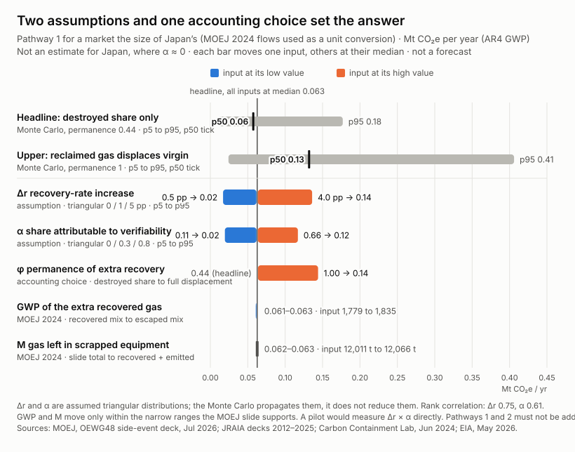

# Climate impact: assumptions propagated, not a forecast

Kigali Balance is an enabler. It recovers no gas and claims no carbon credits. This folder shows how
large its effect *could* be under stated assumptions, and which assumption drives the result.
**Nothing here is a forecast.**

The results come from two assumed triangular distributions (Δr and α) and one accounting choice
(permanence). The Monte Carlo propagates those assumptions; it does not reduce them. A p5–p95 range
here means "what follows from these assumptions", not "what we know".

Run: `ai/.venv/Scripts/python.exe analysis/impact/impact_model.py`. It is deterministic (seed
20261017, 100,000 draws), and a second run reproduces every output byte for byte.

| File | Contents |
|---|---|
| `params.json` | Every input, with its source URL, `kind` (data / derived / assumption) and `verified` flag |
| `impact_model.py` | Monte Carlo, tornado, rank correlations, pilot size |
| `results.json` | All results |
| `chart-light.svg`, `chart-dark.svg` | Tornado chart for Pathway 1 |

## Why Japan, and what it is not

Japan is used only because it is the one country we found with a published end-of-life mass balance
for HFCs: recovered, emitted, reclaimed and destroyed tonnes. Its flows act as a **unit
conversion**: what one attributable percentage point of recovery is worth in a market of that size.

This is **not an estimate of impact in Japan**. There, recovery is mandated and already tracked
electronically (RaMS), so α ≈ 0. Japanese recovery would also likely fail the regulatory-surplus
test that carbon credits require. The ledger is argued for markets where paid-for recovery is held
back by claims nobody can check.

A second scale reference has been verified. TEAP's Medical and Chemical Technical Options Committee
estimates that **250,000–400,000 t** of controlled ODS and HFCs are decommissioned each year
worldwide, across refrigeration, air-conditioning, heat pumps and foams
([EIA, May 2026, PDF p. 24](https://eia-international.org/wp-content/uploads/2026-EIA-Evaluating-Options-for-Sustainably-Financed-Action-on-ODS-and-HFC-Banks.pdf)).
At that scale, one attributable percentage point is 2,500–4,000 t of gas a year, 21–33 times Japan's
121 t.

That figure is a ceiling for HFC refrigerant, because it includes ozone-depleting substances and
foams. We do not convert it to CO₂e, since the gas mix is not given. We found no verifiable
end-of-life HFC mass balance for Türkiye or for any single EU member state.

## Method

The two pathways come from the proposal (`docs/proposal/02_計畫書.md` §8). **They must not be
added**, because they can cover the same gas.

**Pathway 1, more recovery:** ΔE₁ = M × Δr × GWP × α × φ.

- φ is **permanence**. Recovered gas that is *destroyed* avoids its emission for good. Recovered
  gas that is *reclaimed* goes back into the equipment stock. Under a binding quota it adds to
  supply instead of displacing virgin gas, so its avoided emission is at most a delay. Carbon
  Containment Lab shows this for the US: in 2022, 271.7 million of 273.5 million allowances were
  used, and when the quota is used up, "reclaimers do not displace any virgin refrigerant supply"
  ([CCL, Jun 2024](https://carboncontainmentlab.org/documents/for-upload_technical-note-on-hfc-reclamation.pdf)).
- **Headline** counts only the destroyed share: φ = 2,869 / (2,869 + 3,712) = 0.44 (MOEJ 2024).
- **Upper bound** assumes reclaimed gas fully displaced virgin gas (φ = 1). That is possible only
  where the quota does not bind.

**Pathway 2, blocking virgin gas sold as "reclaimed":** ΔE₂ = GWP × β per tonne blocked.

**Sensitivity:**
- A one-at-a-time tornado on the headline: each assumption at its p5/p95, φ between its two cases,
  and M and GWP between the two values the source supports. The others stay at their median.
- Spearman rank correlation over the draws.

## Inputs

| Input | Value | Kind | Source | Verified |
|---|---|---|---|---|
| Recovered at disposal, Japan 2024 | 5,188 t | data | [MOEJ, OEWG48 deck, slide 6](https://www.jraia.or.jp/english/relations/file/260724_oewg48_sideevent_moej_presentation.pdf) | yes, 2026-10-17 |
| Emitted at disposal, Japan 2024 | 6,878 t; 12.62 MtCO₂e | data | same | yes |
| Emitted during use, Japan 2024 | 6,283 t | data | same | yes |
| Destroyed / reclaimed after recovery, Japan 2024 | 2,869 t / 3,712 t | data | same | yes |
| **M** = recovered + emitted | 12,066 t/yr | derived | same | yes |
| **GWP** of escaped gas = 12.62 Mt ÷ 6,878 t | 1,835 tCO₂e/t | derived | same | yes |
| **φ** headline = destroyed share | 0.44 (upper: 1) | derived / bounding case | same; CCL 2024 | yes |
| Global decommissioned ODS + HFC | 250,000–400,000 t/yr | data, scale only | TEAP MCTOC via EIA 2026 | yes |
| GWP (AR4): R-404A, R-134a, R-410A | 3,922; 1,430; 2,088 | data | [Reg. (EU) 2024/573](https://eur-lex.europa.eu/eli/reg/2024/573/oj) | not re-read here (taken from `simulator/params.json`) |
| **Δr**, increase in the recovery rate | triangular 0 / **1** / 5 pp | **assumption** | anchors below | n/a |
| **α**, share of Δr due to verifiability | triangular 0 / **0.3** / 0.8 | **assumption** | none exists | n/a |
| **β**, share of a blocked tonne eventually emitted | triangular 0.57 / **0.72** / 0.95 | **assumption** | anchored to MOEJ flows | n/a |

**Δr anchors, as the sources state them:**

- Japan's recovery rate was "around 30%" in a 2007–12 chart
  ([JRAIA 2012](https://www.jraia.or.jp/english/relations/file/RegionalSymposium-1.pdf)).
- It was about 38% in FY2015 ([JRAIA 2017](https://jraia.or.jp/english/relations/file/presentation1_2017.pdf)).
  We found no 2013–14 figures, so this step cannot be dated to the 2015 Act.
- It was "nearly 40%" in 2017 ([JRAIA 2019](https://www.jraia.or.jp/english/relations/file/presentation2_2019.pdf)).
- It then rose "from 40% to 44%", which JRAIA says only "might be the effect of the revised Act"
  ([JRAIA 2025](https://www.jraia.or.jp/english/relations/file/2507asap_%20OEWG47%20Sideevent_JRAIA%20Ms.%20Yamanaka%20presentation.pdf)).
- It was 43% in 2024 (MOEJ), far below the 2019 goal of more than 70% by 2030.
- New Zealand's carbon-priced scheme has raised end-of-life recovery to 11% (EIA 2026, PDF p. 21).

So under penalty-backed law the rate rose about 13 pp over 12–17 years, at most about 1 pp a year, and
no reform's own effect is cleanly identified. A voluntary data layer is weaker than a law. We
therefore use a mode of 1 pp, a maximum of 5 pp (just above the hedged 4 pp change), and 0 as a real
possibility. This replaces the earlier 0 / 2 / 8, whose 8 pp compared a period average with a single
later year.

**α.** No study separates the effect of verifiability from the effect of the payment itself.
- α can be 0, because refund schemes such as
  [Norway's](https://www.skatteetaten.no/en/business-and-organisation/vat-and-duties/excise-duties/about-the-excise-duties/hfc-and-pfc/)
  pay on delivered gas without a shared ledger.
- It stays below 1, because the payment is the direct cause.
- The range applies to markets where verification is the bottleneck. In Japan α ≈ 0.

**β.** In Japan's 2024 flows, 57% of the gas reaching disposal escaped; that ignores leaks during
use, so it is a floor. Of all gas leaving the stock, 72% was emitted. The upper value of 0.95 stands
for markets with little recovery. Japan is a proxy here, because no EU flow table was verified.

**Source check.** The MOEJ slide's own "remaining at disposal" total (12,011 t) is 55 t less than
recovered + emitted. The slide says its figures "will be further examined".

Context only, from the repo's notes, not re-read and not used in any calculation:
- EU seizures were about 250 t in 2023 and 670 t in 2024.
- Reclaimed R-404A cost about 140% of virgin in Q1 2025.

## Results

**Pathway 1, market the size of Japan's** (MtCO₂e/yr; Δr and α drawn, all else fixed):

| Variant | p5 | p50 | p95 | mean |
|---|---|---|---|---|
| **Headline:** destroyed share only (φ = 0.44) | 0.011 | **0.057** | 0.18 | 0.071 |
| Upper: reclaimed gas fully displaces virgin (φ = 1) | 0.024 | 0.13 | 0.41 | 0.16 |

The attributable rise in the recovery rate, Δr × α, is p5 0.11, p50 0.6 and p95 1.8 percentage
points. In a market of this size, one attributable point is 121 t of gas. That is 0.097 MtCO₂e/yr
on the headline and 0.22 on the upper bound.

The proposal's scenarios had no permanence factor: 0.11, 0.33 and 0.78 MtCO₂e/yr. Even against the
*upper* variant they sit at about the 42nd and 90th percentiles and above essentially every draw. The
proposal's "medium" and "optimistic" cases are not supported by these assumptions.

**Pathway 2, per tonne blocked.** tCO₂e avoided, gross:

| Gas | GWP | p5 | p50 | p95 |
|---|---|---|---|---|
| R-404A | 3,922 | 2,450 | 2,910 | 3,470 |
| R-410A | 2,088 | 1,300 | 1,550 | 1,850 |
| R-134a | 1,430 | 890 | 1,060 | 1,260 |
| Japan disposal mix | 1,835 | 1,150 | 1,360 | 1,620 |

These are **gross, lifetime** figures:

- **Gross.** The servicing demand the blocked tonne would have met is most likely met instead by
  legal quota gas or genuine reclaimed gas, not only by another illegal tonne. The net effect is
  only the part of the blocked tonne that is not replaced.
- **Lifetime.** The figures carry no timing: the emissions would occur over years of leaks and at
  disposal.
- **No total.** No source gives the tonnage the ledger would block.

## Which inputs dominate

Two assumptions and one accounting choice set the answer. On the headline (0.063 with all inputs at
their median):

| Input | Moved | Result, MtCO₂e/yr | Spearman ρ |
|---|---|---|---|
| Δr | 0.5 → 4.0 pp (p5 → p95) | 0.017 → 0.14 | 0.75 |
| α | 0.11 → 0.66 (p5 → p95) | 0.019 → 0.12 | 0.61 |
| φ | 0.44 → 1 (headline → upper) | 0.063 → 0.14 | n/a (fixed per variant) |

GWP (1,779 for the recovered mix versus 1,835 for the escaped mix) and M (12,011 versus 12,066 t)
move the result by 3% and under 1%. That only reflects the narrow ranges the MOEJ slide supports. It
does not show that the slide is right, nor that a Japan-sized market is the right size.

Δr and α enter only as a product, so a pilot should measure Δr × α itself.

## What would resolve it

Run a pilot with three arms, matched on equipment type, age, charge and region:

- **(A)** a payment per recovered kg, verified through the ledger;
- **(B)** the same payment, verified on paper;
- **(C)** no payment.

**Measure the outcome the same way in every arm, independently of the ledger and of paper records:**
a physical audit of a random sample of scrapped units, checking whether the gas was recovered and
how much. Paper records are what fraud inflates. If arm B were scored on its own paperwork, it would
look better than it is.

A − B then estimates Δr × α, A − C estimates Δr, and α = (A − B) / (A − C). The audit also tracks
whether recovered gas went to destruction or reclamation, which pins down φ.

Units per arm, for a two-proportion test (two-sided 5%, power 80%). The baseline is a 43% share of
units recovered, with Japan's mass rate as a stand-in.

| Difference to detect | Unclustered | With clustering (illustration: 20 units per technician, ICC 0.05, design effect 1.95) |
|---|---|---|
| 1 pp | 38,600 | 75,200 |
| 2 pp | 9,700 | 18,800 |
| 4 pp | 2,400 | 4,700 |
| 8 pp | 610 | 1,200 |

Clustering by technician or site raises every number by the design effect 1 + (m − 1) × ICC. The
ICC above is an assumption; no measured value was found. The model's median attributable effect is
about 0.6 pp, so a pilot of a few thousand units can rule out the upper end but cannot measure the
median.

## Honest limits

- **Attribution is the weak link.** α has no empirical basis, and in Japan it is about 0. The ledger
  does not pay for recovery; it makes paying for recovery safe. Any gain belongs first to whoever
  pays.
- **The pathways do not add.** A blocked fake "reclaimed" tonne and an extra recovered tonne can be
  the same gas.
- **Not a forecast.** These are consequences of stated assumptions, converted with one country's
  2024 flows.
- **Reclaimed gas is not a permanent saving under a binding quota.** The headline counts only
  destroyed gas, and φ = 0.44 is Japan's current split. Extra recovered gas could go more to
  reclamation, given the reclaimed premium, or more to destruction, given destruction credits.
- **Pathway 2 is gross.** It depends on what replaces the blocked tonne.
- The MOEJ flow slide is itself an estimate, marked for further review.
- We do not cite the unverified claim that about half of the Italian market is illegal.
