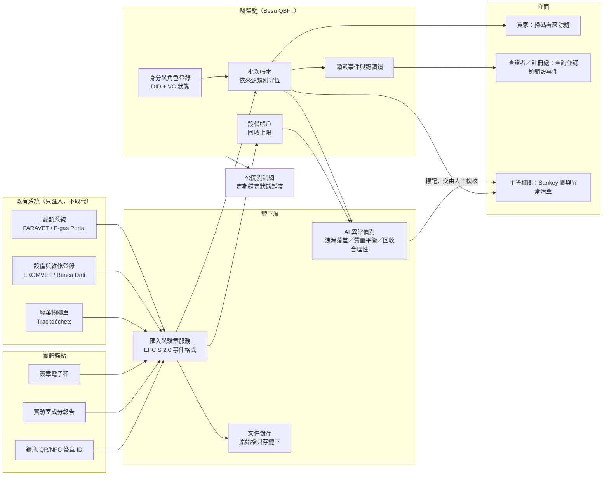

# Kigali Balance 計畫書

**IEEE ClimateChain Global Hackathon 2026｜主賽道三：永續供應鏈（兼賽道一：碳市場與排放透明）**
版本 v1｜2026-10-15｜交件截止：2026-10-25 22:00（台北時間，GMT+8）

> 這份計畫書是團隊的施工藍圖，用中文寫。交件用的英文文件（Devpost 專案說明、PDF 附件、README、影片腳本）都從這份計畫書衍生。問題陳述已定稿，見 [01_問題陳述_Problem_Statement.md](01_問題陳述_Problem_Statement.md)。主題的取捨過程見 [00_主題確認與反思紀錄.md](00_主題確認與反思紀錄.md)。

---

## 目錄

1. 一頁摘要
2. 交件要求與評分標準對照
3. 系統設計
4. 智慧合約規格
5. AI 模組規格
6. 安全與資料完整性評估（威脅模型）
7. Demo 情境與模擬資料
8. 氣候影響與減碳推估方法
9. 標準與法規對照
10. 推廣策略與擴展路線圖
11. 需求驗證計畫
12. 技術選型與 Repo 結構
13. 10 天執行時程與範圍取捨
14. 風險清單
15. 交件檢查表

---

## 1. 一頁摘要

**問題**：HFC 冷媒的紀錄分散在海關配額、技師紀錄、再生業者申報、碳權註冊處等系統。每個系統都在核對自己的紀錄（美國再生業者申報進料與產出、Isometric 逐容器質量對帳、日本電子行程管理票），但沒有人在這些系統**之間**核對同一公斤。結果是原生或走私冷媒能被標成「再生」賣出，而再生與銷毀都能換碳權：一公斤在某個註冊處拿到碳權後，只靠一紙聲明擋住同一份宣稱在別處再算一次。

> **2026-10-15 第十輪反思後的修正**：跨境情境改為「為銷毀而進口」（歐盟 2024/573 第 22(2) 條：進口一律視為原生氣體，只有第 16(2)(a) 條的為銷毀而進口免配額），不再主打「土耳其再生冷媒賣到歐盟」；既有系統補上美國 EPA、歐盟第 26 條、iPIC、Isometric；隱私改為如實描述；合約補上 H1（回收需設備持有者共同簽章）、H4（銷毀證明由獨立查證者簽署）、M8（回收上限計入補充量）、M1（鋼瓶唯一性）。詳見 [03_第十輪反思_評審視角.md](03_第十輪反思_評審視角.md)。

**核心規則**：每一公斤被宣稱為「再生」或「銷毀」的冷媒，都必須追溯到從一台真實、已登錄的設備回收出來的一公斤。

**解法三層**：
| 層 | 負責什麼 | 不負責什麼 |
|---|---|---|
| 實體錨點 | 讓資料接近物理真實：簽章鋼瓶 ID、簽章秤重、實驗室簽章成分報告、國家登錄系統的設備 ID | 不保證沒有人串通 |
| 共享帳本 | 讓多方的說法彼此一致：公斤守恆、來源類別不可混用、銷毀事件只能被一個註冊處認領 | 看不到鋼瓶裡裝什麼 |
| AI | 找出「合規但不合理」的地方：洩漏落差、質量平衡異常、回收合理性 | 不自動處罰任何人 |

**Demo 一句話**：一位再生業者手上只有 8 kg 有文件的回收冷媒，卻想以「再生 R-404A」名義賣出 20 kg，帳本當場擋下多出的 12 kg，AI 同時標記它的產率異常；接著一筆銷毀事件被台灣的模擬註冊處認領後，另一個註冊處再來認領就被拒絕。

---

## 2. 交件要求與評分標準對照

### 2.1 兩個官方頁面的交件要求

| 項目 | Devpost | IEEE 頁面 | 我們的交付物 |
|---|---|---|---|
| 賽道說明 | ✅ | — | 標題與說明第一行寫明 Track 3（兼 Track 1）。Devpost 表單沒有賽道欄位 |
| 專案說明（問題、解法、使用者、擴展性、易採用） | ✅ | — | Devpost 說明欄，由本計畫書第 1、3、10 節改寫 |
| Demo 影片 | 3–5 分鐘 | 3 分鐘 | **控制在 3:00–3:20**，同時滿足兩邊 |
| 公開 Repo 與文件 | ✅ | ✅ | GitHub，README 含架構圖、安裝步驟、合約位址 |
| 可運作的原型 / PoC | ✅ | ✅（testnet 可） | 本機 Besu 聯盟鏈＋公開測試網錨定，見第 12 節 |
| 架構圖與技術規格 | — | ✅ | 第 3、4、5 節 → PDF 附件 |
| 安全與資料完整性評估 | — | ✅ | 第 6 節 → PDF 附件 |
| 問題陳述與解法概述（2 頁內） | — | ✅ | **已完成**（Kigali_Balance_Problem_Statement.pdf） |
| 氣候影響評估與減碳推估 | — | ✅ | 第 8 節 → PDF 附件 |
| 推廣策略與擴展路線圖 | — | ✅ | 第 10 節 → PDF 附件 |
| 使用者測試結果（如有） | — | 選填 | 第 11 節：若截止前能訪談到 1–2 位業界人士就附上，否則寫明「尚未進行」 |

**做法**：Devpost 要求上傳檔案（參賽者回報上限 35 MB），所以把 IEEE 頁面多要求的四項，加上 2 頁問題陳述，合併成一份英文 PDF 附件，一次滿足兩套要求。

### 2.2 評分標準對照

IEEE 頁面的權重：氣候影響 30%、技術創新 30%、可行性 10%、資料安全 10%、使用者體驗 10%、擴展性 10%。Devpost 列了五項但沒有權重。

| 評分項目 | 我們用什麼拿分 | 對應章節 |
|---|---|---|
| 氣候影響（30%／Climate Impact） | 冷媒庫存 13–24 GtCO₂e、日本報廢逸散 12.6 MtCO₂e／年；透明的推估公式與假設 | 8 |
| 技術創新（30%／Innovation） | 依來源類別分開記帳的質量守恆、銷毀事件認領鎖、「回收量不能超過設備充填量」的物理規則；黑客松作品集中查無前例 | 3、4 |
| 技術執行（Devpost） | 合約不變量測試、可運作的端到端 Demo、測試網上可查的交易 | 4.5、7、12 |
| 可行性（10%）／實用性 | 匯入既有系統而不取代；業者為了碳權資格和再生溢價主動加入 | 10 |
| 資料安全（10%） | 完整威脅模型、簽章鏈、金鑰輪替、加密敏捷性 | 6 |
| 使用者體驗（10%）／簡報 | 三種角色的介面：買家掃碼看來源、查證者查銷毀事件、主管機關看 Sankey 圖與異常清單 | 3.4、7 |
| 擴展性（10%） | 聯盟鏈治理、以 GS1 EPCIS 與 W3C VC 對接各國系統、從一個國家擴展到多國 | 9、10 |

**評審背景提醒**：12 位評審中有 4 位是資安或後量子密碼學背景，另有數位產品護照、IoT 溯源、能源與電池 AI、IEEE 標準的專家。所以第 6 節（威脅模型）和第 9 節（標準對照）要寫得紮實，這是多數隊伍會忽略的地方。

---

## 3. 系統設計

### 3.1 參與者與角色

| 角色 | 範例 | 在系統中做什麼 | 身分憑證（VC）由誰簽發 |
|---|---|---|---|
| 進口商／配額持有者 | 土耳其 FARAVET 登錄業者 | 依配額文件發行原生冷媒 | 主管機關（模擬） |
| 經銷商 | 冷媒批發商 | 轉移鋼瓶 | 主管機關（模擬） |
| 維修業者／技師 | 持 MYK 證照的技師 | 灌注、補充、回收（資料來自 EKOMVET 類系統） | 證照機構（模擬） |
| 設備持有者 | 連鎖超市 | 設備登錄、報廢 | 國家設備登錄系統（模擬） |
| 再生業者 | 冷媒再生廠 | 將回收冷媒再生為可販售產品 | 主管機關（模擬） |
| 實驗室 | 認證實驗室 | 簽發成分報告 | 認證機構（模擬） |
| 銷毀廠 | 水泥窯、焚化廠 | 銷毀並產生銷毀事件 | 主管機關（模擬） |
| 碳權註冊處 | Verra、Isometric、台灣自願減量機制（皆為模擬） | 認領銷毀事件以核發碳權 | 聯盟治理委員會 |
| 主管機關 | 臭氧單位、海關 | 查看跨段落異常與總量 | 聯盟治理委員會 |
| 買家 | 超市採購、鐵路公司 | 掃碼查看來源鏈 | 不需憑證（公開檢視） |

### 3.2 架構圖



交件時另外用繪圖工具畫一張乾淨版本放進 PDF 附件。

### 3.3 核心資料模型

**批次（Lot）** 是帳本的基本單位，概念上類似 UTXO：每一批冷媒都有氣體種類、重量、來源類別和父批次。

| 欄位 | 說明 |
|---|---|
| `lotId` | 批次 ID（綁定鋼瓶 ID） |
| `gas` | 冷媒種類，用 ASHRAE 34 代號，例如 R-404A |
| `grams` | 重量，以**公克整數**記錄，避免浮點誤差 |
| `class` | 來源類別：`VIRGIN`（配額支撐的原生）、`RECOVERED`（從設備回收）、`RECLAIMED`（由回收冷媒再生）、`UNKNOWN`（來源不明） |
| `origin` | `VIRGIN` 指向配額文件雜湊；`RECOVERED` 指向設備 ID 與回收事件；`RECLAIMED` 指向父批次 |
| `holder` | 目前持有者 |
| `evidence` | 秤重紀錄、成分報告的雜湊（原始檔在鏈下） |

**關鍵設計：不同來源類別不可互換。** 這就是「拒絕自由分配」的落實方式。帳本不只記「某人有多少公斤」，還記「這幾公斤是哪一類」。所以原生冷媒永遠變不成「再生」，只有 `RECOVERED` 批次經過再生程序才能產生 `RECLAIMED` 批次。

**設備帳戶（Equipment）**：設備 ID、氣體種類、銘牌充填量、安裝日期、狀態（運轉中／已報廢）、累計補充量、累計回收量，以及**登錄來源與信任等級**：

| 信任等級 | 登錄來源 | 適用設備 | 回收上限 |
|---|---|---|---|
| A | 國家登錄系統（例如 EKOMVET），有完整維修歷史；**持有者是登錄系統記載的營運者** | 達法定登錄門檻的設備（例如土耳其 5 tCO₂e 以上） | 銘牌充填量 ×（1＋容許值）＋帳本補充量 |
| B | **第一次服務或報廢時登錄**：技師拍攝銘牌照片並簽章，系統用型號查出原廠充填量；**持有者是設備主人或接收報廢設備的回收點，不能是技師本人** | 低於門檻、沒有登錄的小型設備，例如家用冷氣、小型冷藏櫃 | 型號資料庫的原廠充填量＋帳本補充量；每家維修公司每 30 天的 B 級回收總量另有上限（預設 50 kg） |
| C | **隔離**：不是登錄來源，而是回收當下自動判定。設備安裝未滿 180 天就回收，**全部**算 C 級；否則只有**最近 180 天內經帳本灌注的那幾公克**算 C 級，其餘維持原等級 | 任何設備 | 同 A／B；但 C 級冷媒**不能再生、不能申請碳權**，只能持有、灌回設備或銷毀 |

**為什麼需要 C 級（實作時發現的漏洞）**：如果沒有這條規則，有人可以把原生冷媒灌進一台已登錄的設備，隔天馬上回收，冷媒就從「原生」變成「回收」類別，等於繞過了整個設計。設備的回收上限只能限制每台設備最多洗多少，擋不住這件事本身。

**為什麼只隔離最近灌進去的公克數（寫模擬器時發現第一版會誤傷）**：第一版規則是「最近 180 天內有灌注，整台設備的回收冷媒都算 C 級」。但設備常在報廢前幾週補充冷媒，一台 9 kg 的冷凍櫃報廢前兩個月補了 0.5 kg，第一版會讓 9 kg 全部被隔離。現在只隔離那 0.5 kg（合約的 `recover()` 會同時產生一個正常等級批次和一個 C 級批次，兩者描述同一支鋼瓶）。模擬結果：誠實報廢回收中有 17% 的設備有部分被隔離，但被隔離的質量只占 6.8%；9 次「灌注後立即回收」的洗白嘗試全部被完整隔離。正常維修（回收後灌回同一台設備）不受影響。

**為什麼要分兩級**：土耳其 EKOMVET 只登錄 5 tCO₂e 以上的設備，家用冷氣這類小設備沒有任何紀錄。但日本家用冷氣報廢約占 HFC 排放的 16%，Recoolit 回收的也主要是小型冷氣。如果只承認 A 級，大量真實的回收會被排除在外。B 級讓這些回收也能進入帳本，代價是信任度較低：AI 模組 C 會對 B 級回收做更嚴格的檢查，碳權註冊處也可以自行決定是否接受 B 級來源。

**銷毀事件（DestructionEvent）**：銷毀廠、被銷毀的批次、重量、銷毀證明雜湊（含破壞去除率）、認領狀態（未認領／已被某註冊處認領）。

### 3.4 三種使用者介面

| 介面 | 使用者 | 核心畫面 |
|---|---|---|
| 來源查詢 | 超市、鐵路公司的採購 | 掃描鋼瓶 QR 碼，看到從哪台設備回收、經過誰、何時再生、成分報告是否有效。有問題就顯示紅燈 |
| 查證與認領 | 碳權註冊處、查證機構 | 輸入銷毀事件 ID，看到完整來源鏈，確認後「認領」；已被其他註冊處認領的會被拒絕 |
| 監管儀表板 | 臭氧單位、海關 | 各參與者的公斤 Sankey 圖、AI 異常清單（含理由）、各類別總量 |

---

## 4. 智慧合約規格

### 4.1 合約清單

| 合約 | 職責 |
|---|---|
（已依實作更新，原始碼在 `src/`）

| 合約 | 職責 |
|---|---|
| `IdentityRegistry` | 登錄參與者角色與可驗證憑證雜湊，可撤銷；電子秤、實驗室、**設備持有者（`EQUIPMENT_OWNER`）、銷毀查證者（`VERIFIER`）**的簽章金鑰也以角色登錄 |
| `EquipmentRegistry` | 設備帳戶（A／B 級）、型號資料庫、灌注紀錄、回收上限、駐留規則（C 級）、B 級每月上限 |
| `KigaliLedger` | 批次的發行、轉移、拆分、灌注、回收、再生、銷毀；強制執行守恆規則；在鏈上驗證電子秤與實驗室簽章；電子秤綁定擁有者 |
| `DestructionClaims` | 銷毀事件與認領鎖；各註冊處自訂接受 A 或 A＋B 等級 |
| `Governance` | M-of-N 多簽（例如 4 席、門檻 3）；所有角色授予、撤銷、參數調整都要經過它 |
| `FlagRegistry` | AI 標記的稽核軌跡：記錄模型版本雜湊與輸入快照雜湊，只有主管機關能結案（確認或駁回） |
| `Attestations`（函式庫） | 四種 EIP-712 結構（秤重、成分報告、**持有者回收同意**、**銷毀證明**）與嚴格的 ECDSA 驗章（拒絕 high-s、檢查 v）。驗章集中在一處，但它是編譯進合約的函式庫，換演算法需要重新部署，所以目前只算「保留介面」，不算完整的加密敏捷性 |

### 4.2 守恆規則（R1–R7）

| 編號 | 規則 | 違反時 |
|---|---|---|
| R1 | **發行原生批次**必須引用一份配額文件雜湊，同一份配額文件的累計發行量不得超過額度 | 拒絕交易 |
| R2 | **轉移**必須由轉出方簽署；收方確認時附上自己的秤重，雙方秤重差距超過容許值（參數，預設 1%）就標記 | 差距過大時交易成立但自動標記 |
| R3 | **回收**：**必須附設備持有者的 EIP-712 同意**（指名服務商、公克數、鋼瓶、是否報廢；持有者不能是服務商或綁定在它名下的金鑰）。從一台設備回收的累計公克數，不得超過該設備的回收上限（A 級為銘牌充填量 ×（1＋容許值），B 級為型號資料庫的原廠充填量，**兩者都再加上帳本上的補充量**）；選擇報廢後設備狀態改為已報廢，不能再回收。B 級設備另有每家維修公司每月的回收總量上限。**駐留規則**：設備安裝未滿 180 天就回收則全部標為 C 級；否則最近 180 天內經帳本灌注的公克數標為 C 級 | 沒有持有者同意、超過上限則拒絕交易；駐留不足的部分標為 C 級 |
| R4 | **再生**：只能消耗 `RECOVERED` 批次；產出的 `RECLAIMED` 重量 ≤ 投入重量 ×（1－最低損耗率）；必須附上成分報告雜湊 | 拒絕交易 |
| R5 | **類別不可互換**：`VIRGIN` 和 `UNKNOWN` 不能進入再生程序 | 拒絕交易 |
| R6 | **銷毀**：只能銷毀自己持有的批次；**銷毀數量與破壞去除率由獨立查證者以 EIP-712 簽署**（查證者不能是銷毀廠或綁定在它名下的金鑰，數量必須等於進料秤重）；只有來源可追溯到設備回收的批次，才標記為「可申請碳權」 | 沒有獨立證明則拒絕；不可追溯的批次可以銷毀，但不能申請碳權 |
| R7 | **認領鎖**：每個銷毀事件只能被一個註冊處認領一次；認領需註冊處簽署 | 拒絕重複認領 |
| 鋼瓶 | 每個批次都綁定一個鋼瓶 ID；**每支鋼瓶同時只能有一個未結批次**（同一次回收拆出的在役與 C 級部分除外），批次結清後鋼瓶才能再用 | 拒絕把第二個批次放進同一支鋼瓶 |

### 4.3 為什麼用「認領鎖」，而不是之前提的「空值化指紋」

研究報告原本建議讓各註冊處比對一個由事件資料算出的雜湊指紋。重新檢查後發現這個做法有漏洞：造假者只要改動檢驗報告的任一欄位，算出來的指紋就不同，比對就會失效。

改成**認領鎖**以後，銷毀事件本身就是帳本上的一筆狀態。它只能由持有批次的銷毀廠產生，而批次又受守恆規則約束。註冊處要核發碳權，必須在鏈上「認領」這個事件，而事件只能被認領一次。這樣就不依賴任何人提交的雜湊值是否一致。

### 4.4 不變量（寫成自動化測試）

1. **質量守恆**：對每一種氣體，所有持有中批次的總重 ＋ 已銷毀總重 ＋ 已申報損耗 ＝ 所有原生發行總重 ＋ 所有回收總重。
2. **類別單向**：`RECLAIMED` 批次的所有祖先中，至少有一個是 `RECOVERED`，而且沒有任何 `VIRGIN`。
3. **設備上限**：每台設備的累計回收量 ≤ 銘牌充填量 ×（1＋容許值）。
4. **認領唯一**：每個銷毀事件最多被認領一次。

（已依實作更新）實際的模糊測試共 9 條：上面 4 條，加上 live 等於開放批次總和、可申請碳權的事件只含回收、配額不超額、**沒有未經持有者同意的回收**、**沒有銷毀廠自我證明的銷毀**。後兩條的攻擊動作由模糊測試主動產生：256 輪 × 128 步中，未經同意的回收被擋 2,424 次、自我證明的銷毀被擋 1,842 次，沒有一次成功。

### 4.5 合約安全做法

- 用 Foundry 的 invariant / fuzz 測試驗證上述四條不變量。
- 用 Slither 做靜態分析，結果放進 Repo。
- 所有狀態變更都要求角色檢查與簽章；高風險操作（例如調整參數）需要多方簽署。

---

## 5. AI 模組規格

**原則**：AI 只負責「找出合規但不合理的地方」。每個模組都要輸出**分數＋人看得懂的理由**，而且一律是「標記，交由人工複核」。**不做聊天機器人，不用大型語言模型生成任何判斷。**

### 5.1 模組 A：洩漏落差偵測

| 項目 | 內容 |
|---|---|
| 要回答的問題 | 這台設備申報的補充灌注量，和同類設備的合理洩漏量差多少？ |
| 動機 | 日本 2024 年業者申報洩漏 575 噸，國家盤查估計 6,283 噸，相差十倍以上 |
| 輸入 | 設備類型、銘牌充填量、年齡、歷年補充灌注紀錄 |
| 方法 | 先用 IPCC 指南的設備類別洩漏率區間建立「物理基準」（例如商用冷凍的年洩漏率遠高於家用空調；確切數值需在實作前從 IPCC 2006 指南第 3 冊第 7 章核對）。再對「實際補充量 ÷ 基準」的殘差做異常偵測，並用同類設備的分佈算 z 分數 |
| 輸出 | 兩種標記：補充量遠高於基準（持續洩漏，需要檢漏），以及長期零補充但年齡很高（可能低報或沒在登錄） |

### 5.2 模組 B：質量平衡異常

| 項目 | 內容 |
|---|---|
| 要回答的問題 | 這個參與者的進出量和產率，和同類參與者比起來合理嗎？ |
| 輸入 | 各參與者在帳本上的進出量、再生產率、交易時間分佈；模擬的帳外發票資料 |
| 方法 | 特徵工程（再生產率、轉出／轉入比、月度波動、交易對手集中度）加上 Isolation Forest 計算異常分數；用 SHAP 值說明是哪個特徵造成異常 |
| 輸出 | 例如「再生業者 X：產率 97%，同業中位數 88%，主要原因是產率特徵」。產率數字只是 Demo 模擬值，真實的損耗區間要在需求驗證時向業者確認 |

**實作結果（2026-10-15，已依實作更新）**：主要的偵測力不是來自 Isolation Forest，而是**逐公克對帳**：把每張發票對到 ±21 天內同一買家、同一冷媒的帳本出貨（可拆可併），找不到出貨支撐的公克數就是證據。再生廠則看「嘗試超過 98% 上限被拒的次數」和「產率在同業中的百分位」。Isolation Forest＋SHAP 保留為輔助訊號（權重上限 0.5，單獨不能觸發標記），評估顯示它沒有可量測的改善。在 20 個保留的模擬種子上：精確率 1.0、誤報 0；天真型造假 100% 抓到；會調整行為的造假（夾帶在 5% 容許內、產率只推高 3 點）沒有被標記，但它們能藏的量只有天真型的 1.8%（經銷商）和約一半（再生廠）。完整報告：`ai/reports/module_b_evaluation.md`。

### 5.3 模組 C：回收合理性

| 項目 | 內容 |
|---|---|
| 要回答的問題 | 這次回收出來的量和成分，符合這台設備的條件嗎？ |
| 輸入 | 設備年齡、銘牌充填量、洩漏紀錄、回收重量、成分報告 |
| 方法 | 用設備歷史推估「報廢時合理的殘留量」，比較實際回收量；另外檢查「剛登錄就報廢」「回收量剛好貼著上限」這類模式 |
| 輸出 | 標記可疑的回收事件。**待驗證的假設**：從舊設備回收的冷媒，純度通常不會像全新冷媒那麼高；若某批「回收」冷媒的純度和原生冷媒一模一樣，可能是用原生冷媒冒充。這個判準要先找實驗室確認才能當主要訊號 |

### 5.4 為什麼這不是「垃圾 AI」

1. 每個模組都對應一個有數據支持的痛點：日本十倍的洩漏落差、EIA 記錄的「原生冒充再生」、碳權市場的造假歷史。
2. AI 的輸入就是帳本上有簽章的資料，不是爬網路或使用者自填的內容。
3. 輸出有理由、可以被質疑，而且決定權在人手上。
4. 拿掉 AI，帳本照樣能擋住明確違規；AI 處理的是規則抓不到、「合規但不合理」的灰色地帶。兩者分工清楚。

---

## 6. 安全與資料完整性評估（威脅模型）

### 6.1 信任假設

- 至少有一個獨立的交易對手是誠實的（例如收貨方會自己秤重）。
- 認證實驗室和銷毀廠的簽章金鑰沒有全部外洩。
- 聯盟節點中，沒有單一陣營掌握多數（見 T10）。
- 帳本**不**假設任何單一參與者誠實，也**不**假設資料一開始就是真的。

### 6.2 威脅與對策

| 編號 | 威脅 | 影響 | 對策 | 剩餘風險 |
|---|---|---|---|---|
| T1 | 登錄假設備，用來「回收」原生冷媒 | 原生冒充回收 | A 級設備必須來自國家登錄系統且有簽章；B 級設備需銘牌照片、型號查核、**獨立持有者（回收點）的同意**，並受技師每月總量上限約束；AI 模組 C 標記「剛登錄就報廢」「回收量貼上限」「同一技師 B 級回收量異常」「同一回收點代簽集中」 | 國家登錄系統本身被滲透；技師與回收點串通（模擬器中的幽靈 B 級就是這種，交給 AI）；B 級上限依地址而非組織計算（已知限制 H2） |
| T2 | 竄改電子秤讀數 | 重量造假 | 電子秤以裝置金鑰簽章並綁定擁有者；轉移時收方用自己的秤重新秤重（R2）；回收重量要和持有者同意的重量一致，銷毀重量要和查證者證明一致 | 雙方串通；校正證書目前只以角色登錄，沒有鏈上到期日（已知限制）；轉出方送出時不秤重 |
| T3 | 偽造成分報告 | 冒充回收或再生冷媒 | 只接受認證實驗室的簽章報告，報告綁定鋼瓶 ID 與採樣編號 | 實驗室本身舞弊 |
| T4 | 回收技師與再生業者串通 | 憑空增加回收量 | 設備層級的回收上限（R3）；AI 模組 B、C 交叉偵測；隨機實地稽核 | 大規模、長期串通 |
| T5 | 同一銷毀事件在兩個註冊處各申請一次碳權 | 碳權重複核發 | 認領鎖（R7） | 註冊處不使用本系統 |
| T6 | 參與者私鑰外洩 | 冒名交易 | 金鑰輪替、VC 撤銷清單、高價值操作需多重簽署、銷毀廠與實驗室使用硬體安全模組 | 撤銷之前已發生的交易需人工處理 |
| T7 | 匯入資料被竄改（來自國家系統的資料不實） | 錯誤資料入帳 | 只接受簽章匯出檔；每筆匯入都記錄來源雜湊，可追溯是哪個系統、哪個版本 | 來源系統本身錯誤 |
| T8 | 商業機密外洩（競爭者看到彼此的交易量） | 業者不願加入 | **目前的實作**：原始文件（秤重明細、成分報告、銷毀證明）只存鏈下，鏈上只有雜湊；但批次的公克數、持有者、配額、銷毀事件是合約的公開狀態，**聯盟成員都看得到**，公開測試網只錨定狀態雜湊。**正式版本的路線**：鏈上改存加鹽承諾值（commitment），守恆以範圍證明或零知識證明檢查；或改用 Besu 隱私群組加輪替的化名地址 | 黑客松版本沒有做到批次層級的保密，問題陳述第 7 節已如實揭露 |
| T9 | 智慧合約漏洞 | 守恆規則被繞過 | 不變量／模糊測試、靜態分析、最小權限設計 | 未知漏洞，正式上線前需第三方稽核 |
| T10 | 治理被單一陣營掌控（TradeLens 的教訓） | 系統失去中立 | 驗證節點分散給主管機關、註冊處、產業公會、公民團體；任何一方都不過半 | 聯盟協商失敗 |
| T11 | 個資與資料主權（歐盟 GDPR、土耳其 KVKK、台灣個資法） | 法律風險 | 技師等個人身分只以化名 DID 上鏈，可識別個資只存在鏈下並受當地法規管理 | 跨境傳輸規則需逐國確認 |
| T12 | 密碼學演算法未來被破解 | 長期紀錄的簽章失效 | 驗章集中在一個函式庫，保留換成 NIST 後量子簽章 ML-DSA（FIPS 204）的介面 | **目前換演算法需要重新部署合約**；正式版本應把驗章抽成可經治理替換的合約 |
| T13 | **灌注後立即回收的洗白**：把原生冷媒灌進已登錄設備再馬上回收，冒充「回收」 | 原生冒充回收，進而再生或申請碳權 | 駐留規則：最近 180 天內經帳本灌注的公克數（新安裝設備則為全部）在回收時自動標為 C 級，C 級不能再生、不能申請碳權（`Laundering.t.sol` 專門測試、模糊測試不變量、模擬器 9 次嘗試全部被完整隔離） | 冷媒真的在設備中運轉超過 180 天後才回收，物理上就是合法回收，受設備回收上限約束 |
| T14 | **未經同意的回收**：技師用自己的（真的）秤，把走私冷媒記成「從某台已登錄設備回收」，不經灌注、繞過駐留規則（第十輪反思發現） | 原生冒充回收，拿到 A 級並可申請碳權 | 每次回收都要設備持有者的 EIP-712 同意，指名服務商、公克數、鋼瓶；持有者必須持有 `EQUIPMENT_OWNER` 角色且獨立於服務商（`Provenance.t.sol` 7 個測試、模糊測試不變量 8、模擬器 22 次嘗試全部被擋） | 持有者與技師串通 |
| T15 | **銷毀廠自我證明**：銷毀廠自己宣稱破壞去除率與數量 | 假銷毀拿到碳權 | 銷毀證明由獨立查證者（`VERIFIER`）簽署，數量必須等於進料秤重（`Provenance.t.sol` 4 個測試、不變量 9、模擬器 10 次嘗試全部被擋） | 銷毀廠與查證者串通；查證者獨立性只以地址判斷 |

### 6.3 帳本做不到的事（主動承認）

- **看不到鋼瓶內容。** 物理真實性靠秤重和實驗室檢驗。
- **抓不到從沒進入帳本的冷媒。** 它讓合法冷媒可被證明，並堵住非法冷媒以「再生」名義洗白的出路。
- **擋不住所有參與者全面串通。** 但每多一個獨立的交易對手，串通成本就更高。回收、銷毀這兩個能換錢的步驟，現在都至少要兩個獨立方簽章。
- **黑客松版本不保密。** 聯盟成員看得到批次數量（見 T8）。

---

## 7. Demo 情境與模擬資料

### 7.1 情境腳本：5 個參與者、3 支鋼瓶

| 步驟 | 參與者 | 動作 | 觸發的規則或 AI | 畫面重點 |
|---|---|---|---|---|
| 1 | 土耳其進口商 | 依模擬的配額文件，發行 100 kg R-404A 到三支鋼瓶 | R1 | 只引用配額文件，不重做配額系統 |
| 2 | 經銷商 | 轉 60 kg 給維修業者，接著又想轉出 80 kg | R2 拒絕超量；AI 模組 B 標記另一家經銷商的帳外銷售量超過有文件的進貨量 | 規則擋明顯違規，AI 抓隱藏違規 |
| 3 | 維修業者、超市冷凍櫃 | 灌注設備，模擬 3 年間多次補充 | AI 模組 A 標記累計補充量遠高於同類基準的設備 | 對應日本十倍落差 |
| 4 | 回收技師＋超市（設備持有者） | 最後一次補充的**幾個月後**（實作中為 200 天）設備報廢，回收 8 kg：技師的秤簽重量、超市簽回收同意 | R3 檢查持有者同意與回收上限；駐留規則判定為 A 級 | 實體錨點：兩個獨立簽章。可加演：技師不經同意想記一筆回收，被 `NotUnitOwner` 擋下。**注意：如果補充後馬上回收，補充的那部分會被標為 C 級，招牌畫面就跑不出來** |
| 5 | 再生業者 | 想以「再生 R-404A」名義賣出 20 kg，但只有 8 kg `RECOVERED` 進料；接著改用「混入 12 kg 原生冷媒」再試一次；最後老實再生 7.6 kg，附實驗室報告 | R4 拒絕超量（上限 7.84 kg）；R5 拒絕原生冷媒進入再生；AI 模組 B 標記產率 | **招牌畫面**：洗白在縫隙中被抓到；買家掃碼看到來源鏈 |
| 6 | 銷毀廠＋查證者＋兩個模擬註冊處 | 銷毀 5 kg，查證者簽署銷毀證明，產生「可申請碳權」的銷毀事件；台灣模擬註冊處認領後，另一家模擬註冊處再來認領 | R6、R7 | 跨註冊處唯一性；Sankey 圖呈現所有人的公斤平衡 |

以上六步驟已寫成 `test/DemoScenario.t.sol`，可以直接執行。另有一個可選的加演片段：示範「灌注後立即回收」被駐留規則完整隔離（`test/Laundering.t.sol`）。

### 7.2 模擬資料規格（已依實作更新，程式在 `simulator/`）

- **規模**：2,000 台設備（中大型商用冷凍、獨立式冷藏、冰水主機、家用分離式冷氣四類）、2 家進口商、5 家經銷商、40 家維修公司、4 家再生廠、2 家銷毀廠、2 個註冊處、30 個設備持有者、3 個報廢回收點、2 個獨立查證者，模擬 3 年（2023-10 至 2026-09）。
- **參數來源**：`simulator/params.json`，每個參數都附出處與 `verified` 旗標。報廢回收率校準到日本環境省 2024 年的 43%（20 個亂數種子平均 0.405，範圍 0.27–0.60）；洩漏率取自 IPCC 指南的設備類別區間；GWP 用 AR4 值。
- **兩個世界嚴格分開**：物理真相（真實洩漏率、帳外補充、走私量、造假標籤）只寫進 `ground_truth.json`，**只能用來評估**；AI 只能讀系統觀測得到的 `ledger_events.jsonl`、`invoices.csv`、`equipment.csv`、`actors.csv`。有自動測試檢查觀測資料中沒有任何標籤字樣、設備編號全部是同一空間的隨機序號。
- **注入的造假情境**（第十輪反思後擴充為 9 種，詳見 `HANDOFF.md` 第 6.2 節）：
  1. 帳外補充：6 家維修公司只有 20% 的補充記在帳本上，其餘用走私冷媒（→ AI 模組 A）
  2. 經銷商超賣：2 家。天真型在發票上賣出的量遠超過帳本轉出量；會調整行為的把走私量夾在走私客戶的正常發票裡（每張 ≤ 4%，落在 5% 容許內；總量 ≤ 正常銷售的 2%）。**發票本身看起來完全正常**，AI 必須自己對帳（→ AI 模組 B）
  3. 幽靈 B 級設備：2 家維修公司登錄假的小型設備，由 1 個共謀的報廢回收點代簽持有者同意。一家天真地「回收」型號充填量 97–100%；另一家會調整行為，只回收 85–95%，和誠實回收完全重疊（→ AI 模組 C，必須結合多個訊號，避免評估時的循環論證）
  4. 再生產率灌水：2 家。天真型產率 93–98%，偶爾嘗試超過 98% 上限而被 R4 擋下；會調整行為的只把自己工廠的效率中心推高 3 個百分點。誠實再生廠各有自己的效率中心（87–93%），所以高效率的誠實廠和造假廠會重疊（→ AI 模組 B）
  5. 灌注後立即回收洗白（→ 駐留規則）
  6. 重複認領同一銷毀事件（→ 認領鎖）
  7. 未經持有者同意的回收：帳外補充的維修公司用自己的金鑰簽同意（→ `NotUnitOwner`）
  8. 重複使用鋼瓶：把回收記進一支還有未結批次的鋼瓶（→ `CylinderInUse`）
  9. 銷毀廠自我證明（→ `NotVerifier`）
- **規則鏡像**：`simulator/src/ledger.mjs` 完整複製合約規則，拒絕原因名稱和 Solidity 錯誤相同，並有單調時鐘（時間只往前、相鄰事件至少間隔 60 秒）。
- **每次執行自動檢查**：物理質量平衡、帳本恆等式、每筆接受事件的規則符合性；失敗就停止。
- **差異測試**：`simulator/replay.mjs` 把全部事件重播到本機 Anvil 鏈上的真合約，要求接受／拒絕、拒絕原因、批次編號、各冷媒總量完全一致。最新結果（2026-10-15，加入模組 B 的造假者後）9,752 筆全部一致，包括新攻擊在鏈上以相同錯誤被擋；鋼瓶 ID 由規則鏡像指派，鋼瓶唯一性也被比對。
- **標示**：所有資料、參與者、配額文件都是模擬，不使用任何真實業者名稱或政府資料。
- **用途**：AI 模組的評估指標只代表在模擬資料上的表現，簡報中必須講清楚。

### 7.3 3 分鐘影片腳本（初稿）

| 時間 | 內容 |
|---|---|
| 0:00–0:25 | 問題：一公斤 R-404A ≈ 3.9 噸 CO₂；日本只回收 43%；歐盟查扣量一年變 2.7 倍；「再生」和「銷毀」兩個標籤都能換錢 |
| 0:25–0:45 | 缺口：每一段都有系統，段與段之間沒人管（顯示第 4 節表格） |
| 0:45–1:00 | 核心規則與三層架構 |
| 1:00–2:20 | 現場操作 Demo 步驟 1–6，重點放在步驟 5 和 6 |
| 2:20–2:40 | 安全設計：簽章鏈、認領鎖、威脅模型摘要 |
| 2:40–3:00 | 影響與對齊：COP31 超級污染物支柱、土耳其 F-gas 法規、台灣銷毀方法學；最後一句標語 |

---

## 8. 氣候影響與減碳推估方法

### 8.1 因果鏈

可驗證的回收公斤 → 碳權、生產者延伸責任（EPR）或再生溢價**敢**替回收付錢 → 回收率提高 → 報廢時的逸散減少。

另一條路徑：堵住原生冒充再生 → 配額外的供應減少 → 進入設備、最終逸散的冷媒庫存減少。

### 8.2 推估公式

**路徑一：回收率提升**

ΔE₁ = Σ_g（M_g × Δr × GWP_g）× α

- M_g：氣體 g 在報廢時的殘留量（公噸／年）
- Δr：回收率提升的百分點
- GWP_g：氣體的全球暖化潛勢（採歐盟 F-gas 法規使用的 IPCC AR4 數值，例如 R-404A 為 3,922、R-134a 為 1,430、R-410A 為 2,088）
- α：歸因係數，代表回收率提升中可歸因於本系統的比例（0 到 1）

**示意計算（日本，採 2024 年數據）**：報廢時殘留 12,011 噸，逸散部分平均每公斤約 1.84 tCO₂e。

| 情境 | Δr | α | 每年減量 |
|---|---|---|---|
| 保守 | +1 個百分點 | 0.5 | 約 0.11 MtCO₂e |
| 中等 | +3 個百分點 | 0.5 | 約 0.33 MtCO₂e |
| 樂觀 | +5 個百分點 | 0.7 | 約 0.77 MtCO₂e |

（計算方式：12,011 t × Δr × 1.84 tCO₂e/kg × α。例如保守情境：12,011 × 1% × 1.84 × 0.5 ≈ 0.11 Mt。）

**路徑二：每阻止一公噸原生冷媒冒充再生**

ΔE₂ = 阻止量 × GWP × β

- β：被阻止的冷媒原本最終會逸散的比例（保守取日本報廢未回收率 57% 作為參考）。
- 以 R-404A 為例：每阻止 1 公噸 ≈ 3,922 × 0.57 ≈ 2,240 tCO₂e。

### 8.3 誠實聲明

- 以上全部是**示意推估**，不是預測。α 和 β 都是假設，簡報中要明講。
- 本系統是「促成者」，減量的直接來源是回收和銷毀行為本身。為避免重複計算，本系統不主張自己產生任何碳權。
- 路徑一和路徑二不能相加，因為兩者可能涵蓋同一批冷媒。
- 我們沒有引用「義大利近半市場是非法冷媒」這類未經證實的數字來放大影響。

---

## 9. 標準與法規對照

| 標準／法規 | 內容 | 本系統如何對接 |
|---|---|---|
| IEEE 3218-2022《Standard for Using Blockchain for Carbon Trading Applications》 | 區塊鏈碳交易應用的框架、流程、存取、介面與安全 | 銷毀事件與認領鎖的設計，對照其框架中的功能與安全要求說明（實作前需取得標準全文確認細節） |
| W3C Verifiable Credentials 2.0、DID | 可驗證憑證與去中心化身分 | 參與者證照、實驗室與秤的校正證書、設備身分 |
| GS1 EPCIS 2.0 | 供應鏈事件標準 | 匯入格式：轉移用 ObjectEvent；**再生用 TransformationEvent**（多個投入批次轉成一個產出批次），剛好對應 R4 |
| Isometric HFC & ODS 回收與銷毀協議 v1.0 | 每個容器秤重、成分抽樣、全程監管鏈、破壞去除率 99.99% | 銷毀事件的必填欄位直接對照協議要求 |
| Verra VM0016 v2.0 | HFC／ODS 銷毀碳權方法學 | 「可申請碳權」的判斷條件（R6）對照其適用性要求 |
| CAD Trust 資料模型 | 碳權跨註冊處資料層 | 認領鎖的事件 ID 可對應到 CAD Trust 的單位紀錄 |
| 歐盟 2024/573 第 7 條（紀錄保存）、第 12(7) 條（再生標示須寫歐盟境內再生廠）、第 13 條（維修禁令，再生冷媒豁免到 2030-01-01）、第 16(2) 條（配額豁免，含為銷毀而進口）、第 22(2) 條（進口一律視為原生）、第 26 條與附件 IX（再生量、銷毀量、為銷毀而進口量的年度申報） | 紀錄、標示、再生冷媒豁免、配額、年度申報 | 「再生」批次的標示資訊由帳本產生，可追溯；跨境情境依第 22(2) 條設計：境外再生的冷媒進入歐盟即視為原生，只有為銷毀而進口免配額；帳本可產生第 26 條申報所需的再生進料量（法規本身沒有要求申報這一項） |
| 美國 40 CFR 82.164、84.33、84.112（EPA ER&R 規則） | 再生業者申報進料、產出、廢棄物；會計師年度稽核；每個容器的電子證明；2026 年起原生成分 ≤ 15%；2029 年起特定子部門須用再生冷媒 | 美國境內已有的單一管轄區對帳節點；本系統的再生批次可直接產生同樣欄位的證明，並延伸到跨註冊處 |
| UNEP iPIC | 出貨前由各國臭氧窗口確認進出口商資格（112 國加歐盟，含土耳其） | 互補：iPIC 管出貨前的身分，本系統管交貨後的公斤與回收／再生／銷毀分類 |
| 土耳其《含氟溫室氣體管理規則》（2024-10-15，Resmî Gazete 第 32693 號） | FARAVET 配額、EKOMVET 設備登錄 | 匯入來源（Demo 中為模擬） |
| 台灣《氫氟碳化物管理辦法》（2025-02-25）與廢棄含氟氣體回收銷毀減量方法學草案（2026-07-22 審查） | 執行實績申報、銷毀碳權 | 台灣模擬註冊處的認領規則 |
| AHRI 700 | 再生冷媒純度規格 | 再生批次的成分報告檢查項目 |
| ASHRAE 34 | 冷媒命名 | 氣體種類代號 |

---

## 10. 推廣策略與擴展路線圖

### 10.1 誰付錢、誰受益

| 參與者 | 為什麼願意加入 | 成本 |
|---|---|---|
| 守法的再生業者 | 「可驗證再生」標示能賣出溢價，和打著再生名義的便宜冷媒區隔 | 每批次的驗證費 |
| 碳權註冊處與買家 | 降低重複核發與假銷毀的風險，保護碳權信譽 | 每次認領的查詢費 |
| 大型買家（超市、鐵路） | 合規證明，避免買到非法冷媒的法律與聲譽風險 | 免費查詢 |
| 主管機關 | 跨段落的異常訊號，執法更有效率 | 提供資料匯出介面 |
| 技師 | **不需要額外填寫文件**：灌注、回收紀錄來自他們原本就要申報的系統；秤重本來就是回收紀錄的一部分，只是改用會自動簽章的電子秤 | 簽章電子秤的設備成本，由想取得碳權或再生溢價的一方（再生業者、回收營運商）負擔，不由技師負擔 |

### 10.2 路線圖

| 階段 | 時間 | 目標 | 成功指標 |
|---|---|---|---|
| 0｜黑客松 MVP | 2026-10 | 模擬資料的端到端 Demo、合約不變量測試、威脅模型 | Demo 六步驟全部可運作 |
| 1｜需求驗證 | 2026-11 至 2027-03 | 訪談第 11 節列出的對象，驗證四個假設 | 至少 2 個假設被業界確認 |
| 2｜單一銷毀碳權專案試行 | 2027 | 與一家冷媒回收銷毀營運商合作，用真實批次跑認領流程 | 一個完整的「回收 → 銷毀 → 認領」案例 |
| 3｜土耳其試行 | 2027–2028 | 在土耳其廢 F-gas 通函定案後，與主管機關討論連接 FARAVET、EKOMVET 與報廢端 | 主管機關同意提供資料匯出介面 |
| 4｜多國互通 | 2028 起 | 加入台灣、歐盟成員國的系統，成立中立的治理聯盟 | 兩個以上國家、兩個以上註冊處接入 |

---

## 11. 需求驗證計畫

目前的需求是從公開文件推論的，還沒有訪談過任何業者或主管機關。以下是要驗證的假設和訪談對象。

| 假設 | 驗證方式 | 訪談對象（類型） |
|---|---|---|
| H1：守法的再生業者願意付費取得「可驗證再生」標示 | 訪談、詢問願付價格 | 歐盟或土耳其的冷媒再生業者 |
| H2：碳權註冊處認為跨註冊處重複核發是值得防範的風險 | 訪談、詢問現行防範方式 | 碳權註冊處或查證機構 |
| H3：國家系統能以簽章檔案匯出資料 | 查閱系統文件、詢問主管機關 | 土耳其環境部臭氧單位；台灣環境部 |
| H4：「回收冷媒純度通常低於原生冷媒」可以當作異常訊號 | 詢問實驗室、查閱檢驗數據 | 冷媒檢驗實驗室 |

如果截止前能訪談到 1–2 位，就把結果放進交件附件的「使用者測試」一節；否則就如實寫「尚未進行，已規劃於階段 1」。

---

## 12. 技術選型與 Repo 結構

### 12.1 技術選型

| 元件 | 選擇 | 理由 |
|---|---|---|
| 聯盟鏈 | Hyperledger Besu，QBFT 共識，本機 4 個驗證節點（Docker） | EVM 相容、許可制，符合「聯盟治理」的設計；4 個節點分別代表主管機關、註冊處、產業公會、公民團體 |
| 公開錨定 | 定期把聯盟鏈的狀態雜湊寫到 Ethereum Sepolia 測試網 | 評審可以在公開區塊瀏覽器上查證，符合 IEEE 頁面「testnet 可」的要求 |
| 智慧合約 | Solidity＋Foundry | 不變量與模糊測試工具成熟 |
| 隱私 | 原始文件存鏈下，鏈上只存雜湊與必要狀態；黑客松版本不依賴 Besu 的私有交易功能，所以批次數量對聯盟成員可見（見 T8） | 降低複雜度與相依風險；批次層級保密列入路線圖（承諾值加零知識證明，或隱私群組） |
| 身分 | W3C DID 與 VC（以簡化的 did:key 模擬），簽章採 EIP-712 結構化資料加 secp256k1 ECDSA，可直接在鏈上驗證電子秤與實驗室簽章；驗章集中在一個函式庫，日後可替換為後量子演算法 | 加密敏捷性 |
| 匯入與 API | Python FastAPI；事件格式採 EPCIS 2.0 JSON | 對接各國系統的標準格式 |
| AI | Python：pandas、scikit-learn（Isolation Forest）、SHAP | 可解釋、輕量 |
| 前端 | Next.js＋ECharts（Sankey 圖）＋QR 碼掃描 | 三種角色介面 |
| 模擬資料 | Node.js 產生器（電腦已有 Node，不需另裝 Python），固定亂數種子，參數檔獨立並標註出處 | 可重現；輸出 CSV／JSONL，之後的 AI 模組直接讀取 |

### 12.2 Repo 結構

> 下面是原始規劃。**實際目前的結構**見儲存庫根目錄的 `HANDOFF.md` 第 12 節：模擬器放在 `simulator/`（含差異測試 `replay.mjs`），`network/`、`services/`、`web/` 尚未建立。

```
kigali-balance/
├── README.md                # 英文：問題、架構圖、快速啟動、合約位址、限制
├── docs/                    # 問題陳述 PDF、安全評估、影響推估、路線圖
├── contracts/               # Solidity 合約與 Foundry 測試（含不變量測試）
├── network/                 # Besu QBFT 4 節點 docker-compose
├── services/
│   ├── ingest/              # EPCIS 匯入、驗章
│   └── anchor/              # 定期錨定到 Sepolia
├── ai/                      # 三個 AI 模組、評估 notebook
├── simulator/               # 模擬資料產生器與造假情境
└── web/                     # Next.js 三種介面
```

---

## 13. 10 天執行時程與範圍取捨

### 13.1 範圍分級

| 等級 | 內容 |
|---|---|
| **必做** | 合約 R1–R7 與不變量測試；模擬資料產生器；AI 模組 B（質量平衡）；Demo 步驟 4–6；監管儀表板的 Sankey 圖；影片；英文 PDF 附件；README |
| **應做** | AI 模組 A（洩漏落差）；買家掃碼介面；Besu 4 節點；Sepolia 錨定；Demo 步驟 1–3 |
| **可做** | AI 模組 C（回收合理性）；EPCIS 匯入；完整 VC 撤銷流程；Slither 報告 |

如果時間不夠，從「可做」開始砍。**步驟 5、6 和認領鎖是這個題目的核心，絕對不能砍。**

### 13.2 每日時程

> **實際進度（2026-10-15）**：合約與測試、模擬資料產生器與差異測試都已完成，比原時程提前約兩天。下一步是 AI 模組（原排在 10/18–19）。

| 日期 | 工作 |
|---|---|
| 10/15（四） | 計畫書定稿；開 Repo；合約資料模型與介面定義 |
| 10/16（五） | `KigaliLedger`、`EquipmentRegistry` 實作；R1–R5 單元測試 |
| 10/17（六） | `DestructionClaims`（R6、R7）；不變量測試；模擬資料產生器 |
| 10/18（日） | Besu 網路；Demo 腳本串接；AI 模組 B |
| 10/19（一） | 監管儀表板（Sankey 圖、異常清單）；AI 模組 A |
| 10/20（二） | 查證者介面、買家掃碼介面；Sepolia 錨定 |
| 10/21（三） | 端到端測試；修 bug；AI 模組 C（若有時間） |
| 10/22（四） | 英文 PDF 附件：架構圖、安全評估、影響推估、路線圖 |
| 10/23（五） | 錄影片、剪輯；README |
| 10/24（六） | 全部交件內容檢查；Devpost 說明欄定稿；**預先提交** |
| 10/25（日） | 緩衝。**上午就送出最終版**，不要拖到晚上 22:00 截止前 |

---

## 14. 風險清單

| 風險 | 可能性 | 影響 | 對策 |
|---|---|---|---|
| 評審質疑「為什麼不用資料庫」 | 高 | 中 | 第 7 節（問題陳述）和影片都主動回答：單一國家內確實用資料庫就好（日本 RaMS、美國申報規定都證明了），只有跨註冊處、互相競爭的再生業者、跨境運送去銷毀這三種情境才需要 |
| 評審質疑「土耳其的再生冷媒進入歐盟就變原生了」 | 中 | 高 | 已修正：依歐盟 2024/573 第 22(2) 條，跨境情境只主打「為銷毀而進口」（第 16(2)(a) 條）與「證明有配額支撐」，不主打跨境賣再生冷媒 |
| 評審質疑「美國、Isometric 已經在做質量對帳」 | 中 | 中 | 問題陳述第 4 節已列出，定位為「它們各自在單一管轄區或單一註冊處內對帳，我們做的是它們之間那層」 |
| 評審質疑「銷毀碳權本身就是漂綠」 | 中 | 中 | 承認 HFC-23 的歷史，說明認領鎖和「只有可追溯回收才能申請碳權」正是針對這個問題；本系統也能用在完全不涉及碳權的再生認證 |
| 土耳其評審對「走私」敘事敏感 | 中 | 中 | 敘事放在保護守法的土耳其業者，不把土耳其描述為問題來源 |
| AI 被認為是點綴 | 中 | 高 | 第 5.4 節的四點理由寫進簡報；Demo 中 AI 標記要有明確的理由說明 |
| Besu 環境建置卡關 | 中 | 中 | 備案：先在 Foundry 本機鏈（Anvil）上完成 Demo，Besu 列為「應做」 |
| 需求未經訪談驗證 | 確定 | 中 | 第 11 節的驗證計畫寫進附件，誠實說明 |
| 規則矛盾（截止時間、影片長度） | 已知 | 中 | 影片控制在 3:00–3:20；10/25 上午提交 |

---

## 15. 交件檢查表

- [ ] Devpost 標題含「Track 3（兼 Track 1）」
- [ ] Devpost 說明欄：問題、解法、目標使用者、擴展性、易採用性（英文）
- [ ] 影片 3:00–3:20，上傳 YouTube 並設為公開或不公開連結
- [ ] GitHub Repo 公開；README 含架構圖、快速啟動、合約位址、限制聲明
- [ ] Sepolia 錨定交易連結
- [ ] 英文 PDF 附件：問題陳述（2 頁）＋架構與技術規格＋安全與資料完整性評估＋氣候影響推估＋推廣與路線圖＋需求驗證計畫
- [ ] 所有模擬資料都標示「mock」
- [ ] 所有數字都有出處；推論都有標示
- [ ] 10/25 上午送出
